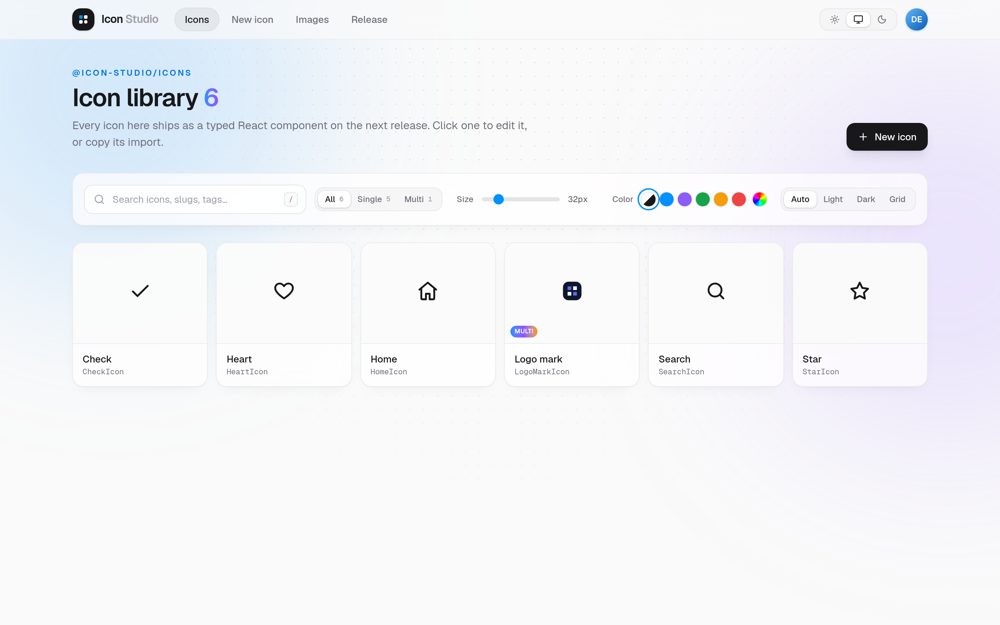
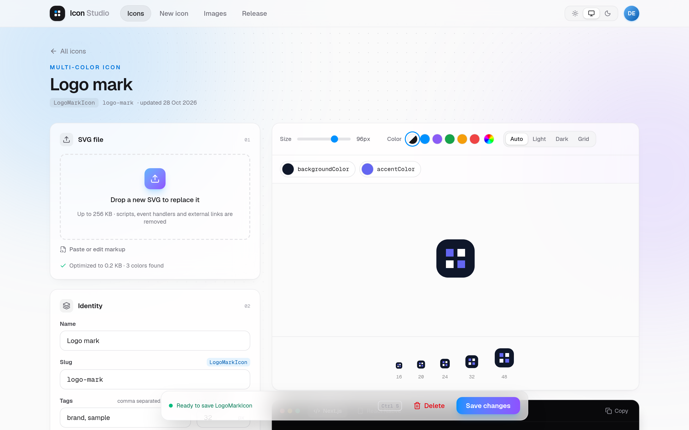
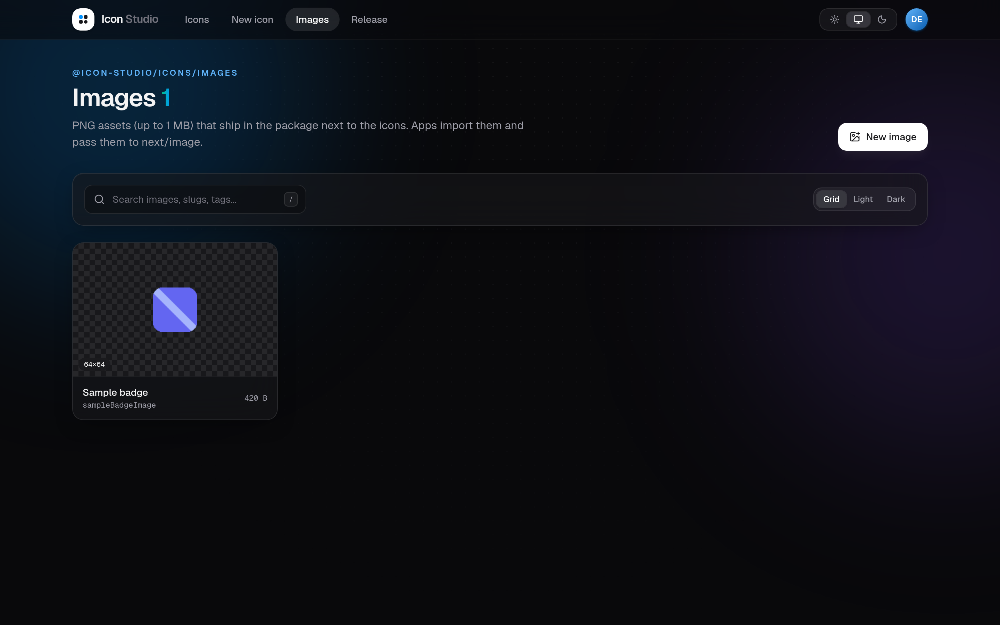
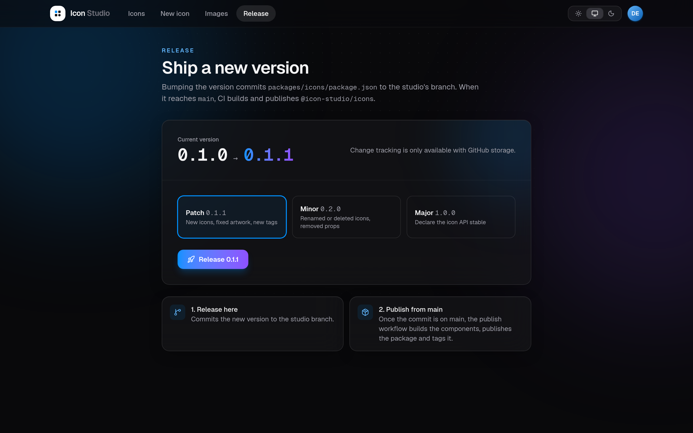
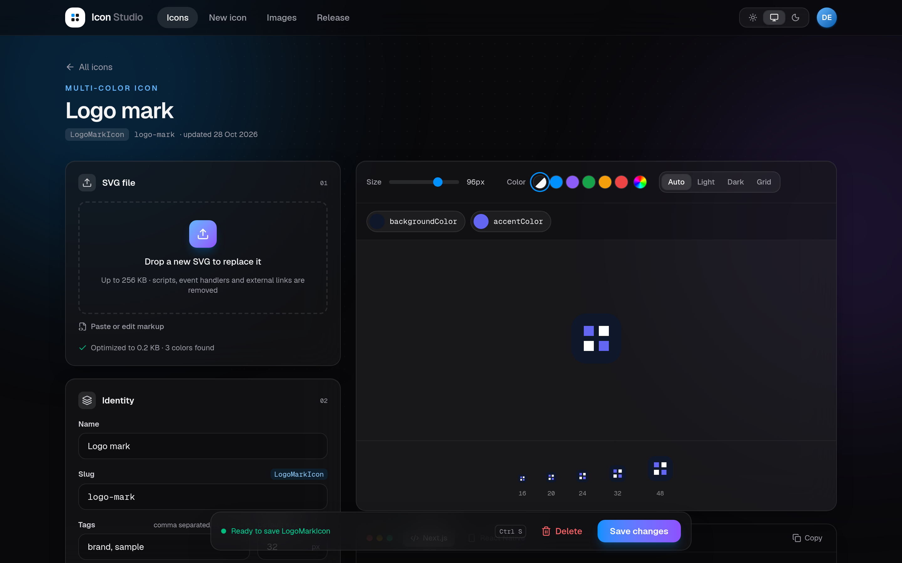

# Icon Studio

[](https://github.com/Harish-venkat84/icon-studio/actions/workflows/check.yml)
[](LICENSE)

**An open-source, self-hosted icon studio.** Upload SVG icons and PNG images in a web UI, preview
and tune them, and ship them as a typed, tree-shakable **React** and **React Native** package.

There is no database. Your icons live in your own Git repository, and every save in the studio is
a commit, so icon changes have history, can be reviewed in pull requests, and can be reverted with
git.

**Live demo: [icon-studio-three.vercel.app](https://icon-studio-three.vercel.app)**, log in with
username `admin` and password `admin`. The demo is read-only: you can browse icons, preview them at
any size and color, try uploading an SVG to see it cleaned up, and copy usage snippets, but saving,
deleting and releasing are turned off.

<picture>
  <source media="(prefers-color-scheme: dark)" srcset="docs/screenshots/gallery-dark.png">
  
</picture>

## Features

- **Upload and clean up SVGs.** Scripts, event handlers, `foreignObject`, external links and
  `url()` references are stripped, then the file is optimized with [SVGO](https://github.com/svg/svgo).
- **Live preview** at any size and color, on light, dark and grid backgrounds.
- **Single-color or multi-color icons.** Single-color icons follow `currentColor` (and Tailwind
  `text-*` classes); multi-color icons can expose colors as props such as `accentColor`.
- **PNG images** (up to 1 MB) in the same package, ready for `next/image` and React Native `Image`.
- **Generated package**: one module per icon, typed props, no hooks and no `'use client'`, so
  icons work in Server Components, Client Components, the Pages Router and React Native.
- **Copy-paste usage snippets** for every icon and image, for web and React Native.
- **Releases from the UI**: bump the version and let CI build, publish and tag the package.
- **Git as storage**: write straight to a local checkout, or commit through the GitHub API when
  the studio runs on a server.
- **Light and dark theme**, keyboard friendly, basic-auth login for teams.

<table>
  <tr>
    <td></td>
    <td></td>
  </tr>
  <tr>
    <td align="center">Icon editor with color props and usage snippets</td>
    <td align="center">PNG images</td>
  </tr>
  <tr>
    <td></td>
    <td></td>
  </tr>
  <tr>
    <td align="center">Releases</td>
    <td align="center">Dark theme</td>
  </tr>
</table>

## Quick start

Requirements: Node.js 24 (see `.nvmrc`) and pnpm 12 (`corepack enable`).

```bash
git clone https://github.com/Harish-venkat84/icon-studio.git
cd icon-studio
pnpm install
cp apps/studio/.env.example apps/studio/.env.local   # ICONS_STORAGE=fs by default
pnpm dev                                              # http://localhost:3030
```

With `ICONS_STORAGE=fs` the studio writes straight into this checkout's `icons/` and `images/`
folders; commit the files yourself. With `STUDIO_USERS` empty, the dev server needs no login.

The repository ships with a few sample icons and one sample image so everything works out of the
box. Delete them and add your own.

## How it works

```
icons/                 source of truth: <slug>.svg + <slug>.json per icon
images/                source of truth: <slug>.png + <slug>.json per PNG image
packages/core          private: SVG sanitizing/optimizing (SVGO), metadata schema, TSX codegen
packages/icons         @icon-studio/icons, generated from icons/ + images/ and published to npm
apps/studio            Next.js app to upload, preview, edit and release icons (port 3030)
```

1. In the studio you upload an SVG and give it a **name** and a unique **slug** (`credit-card`).
   The slug decides the component name (`CreditCardIcon`) and must be unique, including after the
   PascalCase conversion (`home-1` and `home1` would clash).
2. The SVG is sanitized, optimized with SVGO and saved as `icons/<slug>.svg`. The settings go to
   `icons/<slug>.json`.
3. `pnpm generate` turns every icon into a React component and a `react-native-svg` component in
   `packages/icons/src/generated` (gitignored), plus a manifest and a by-name `Icon` component.
4. The **Release** page bumps the version in `packages/icons/package.json`. When that commit is on
   `main`, the `Publish Package` workflow builds the package, publishes it to npm and tags the
   commit `v<version>`. The release page lists the icon files changed since the last tag.

Per icon, the studio sets:

- **Color mode.** _Single color_ turns every color into `currentColor`, so the icon follows
  `text-*` classes. _Keep original colors_ is for logos and illustrations.
- **Color props** (multi-color only). Any color found in the SVG can become a prop such as
  `accentColor`. Its default is the original color. Prop names must end in `Color`.
- **Default size** and an optional **default color**.

## Using the generated package

The examples use the package name `@icon-studio/icons`. In your own fork, rename it (see
[Publishing your own package](#publishing-your-own-package)).

```bash
pnpm add @icon-studio/icons
```

### Props

Every icon accepts all `<svg>` props plus:

| Prop    | Type                 | Notes                                                                |
| ------- | -------------------- | -------------------------------------------------------------------- |
| `size`  | `number \| string`   | Height; width follows the icon's aspect ratio. Default set per icon. |
| `title` | `string`             | Accessible label. Without it the icon is `aria-hidden`.              |
| `color` | `string`             | Sets `currentColor`. Usually you use a `text-*` class instead.       |
| `ref`   | `Ref<SVGSVGElement>` | React 19 ref-as-prop.                                                |

Tailwind sizing classes (`h-6 w-6`) override the `width`/`height` attributes.

### React and Next.js

```tsx
import { HeartIcon, LogoMarkIcon } from '@icon-studio/icons'

<HeartIcon size={24} className="text-rose-500" />
<LogoMarkIcon accentColor="#f59e0b" title="Acme" />
```

**By slug** (when the icon name comes from a CMS, a database or an API):

```tsx
import { Icon, isIconName, type IconName } from '@icon-studio/icons/dynamic'

;<Icon name={item.icon} size={20} fallback={<span className="size-5" />} />
```

`@icon-studio/icons/dynamic` imports every icon, so use it only where the name is really dynamic.
Named imports from `@icon-studio/icons` are tree-shaken (`sideEffects: false`, one module per
icon). The root also exports `Icon` and `iconNames`/`isIconName`; unused, they are tree-shaken
away. `@icon-studio/icons/manifest` exports `iconManifest` (name, slug, component, tags) if an app
needs to list the icons.

For faster dev builds, add the package to `optimizePackageImports` in `next.config.ts`:

```ts
experimental: {
  optimizePackageImports: ['@icon-studio/icons']
}
```

pnpm 10+ can reject packages younger than its `minimumReleaseAge`. To install a release right
after publishing, add the scope to the app's `pnpm-workspace.yaml`:

```yaml
minimumReleaseAgeExclude:
  - '@icon-studio/*'
```

### PNG images

The studio's **Images** page manages PNG assets (up to 1 MB and 8192 px each) the same way:
`images/<slug>.png` plus `images/<slug>.json` (name, slug, alt text, tags; width, height and size
are read from the file). They ship under `@icon-studio/icons/images`, one export per image named
after the slug (`sample-badge` → `sampleBadgeImage`):

```tsx
import Image from 'next/image'
import { sampleBadgeImage } from '@icon-studio/icons/images'

<Image src={sampleBadgeImage} alt="Sample badge" />            // width/height come from the PNG
<Image src={sampleBadgeImage} alt="Sample badge" width={32} /> // scaled, height follows
```

The exports are PNG imports, so the app's bundler must process the package. Add this to the app's
`next.config.ts` (required for the Pages Router, harmless for the App Router):

```ts
transpilePackages: ['@icon-studio/icons'],
```

`imageManifest` in `@icon-studio/icons/manifest` lists every image (name, export, size, alt) without
importing the files. Importing only `@icon-studio/icons` or `@icon-studio/icons/dynamic` never pulls
in any PNG.

### React Native / Expo

The generator also writes every icon as a
[`react-native-svg`](https://github.com/software-mansion/react-native-svg) component, and the
package's `react-native` export condition makes Metro pick those automatically, so the import paths
are the same as on the web:

```bash
npx expo install react-native-svg   # or: pnpm add react-native-svg (bare React Native)
pnpm add @icon-studio/icons
```

```tsx
import { Image } from 'react-native'
import { HeartIcon, Icon } from '@icon-studio/icons'
import { sampleBadgeImage } from '@icon-studio/icons/images'

<HeartIcon size={24} color="#e11d48" title="Favorite" />  // title → accessibilityLabel
<Icon name={item.icon} size={20} fallback={null} />
<Image source={sampleBadgeImage} />                       // a Metro asset
```

- Same component names and props as the web (`size`, `color`, `title`, custom color props), on top
  of `react-native-svg`'s `SvgProps`. There is no `className`.
- Needs a Metro with package `exports` support (React Native 0.79+ / Expo SDK 53+, the default).
  Expo's `tsconfig.base` already sets `customConditions: ["react-native"]`; a bare React Native app
  should add that to `tsconfig.json`, or import from `@icon-studio/icons/native` and
  `@icon-studio/icons/native-images` explicitly.
- `react-native-svg` is an optional peer dependency, so web apps never install it.

## Self-hosting

Run the studio on your own server so your team can manage icons without touching git. On a server
the studio uses **GitHub storage**: every save becomes a commit in your repository through the
GitHub API.

1. Fork or copy this repository (it holds your icons).
2. Create a [fine-grained personal access token](https://github.com/settings/personal-access-tokens/new)
   with access to **only that repository** and **Contents: Read and write**.
3. Create `studio.env` from `apps/studio/.env.example`:

   ```bash
   STUDIO_USERS=alice:a-long-password,bob:another-long-password
   ICONS_STORAGE=github
   ICONS_GITHUB_TOKEN=github_pat_...
   ICONS_GITHUB_REPOSITORY=your-github-user/icon-studio
   ICONS_GITHUB_BRANCH=main
   ```

4. Start it:

   ```bash
   docker compose up -d     # builds the image and serves http://<host>:3030
   ```

   Or without Compose:

   ```bash
   docker build -t icon-studio .
   docker run -d -p 3030:3030 -v "$PWD/studio.env:/app/.env:ro" icon-studio   # the env file is required
   ```

5. Put it behind a reverse proxy with HTTPS (Caddy, nginx, Traefik). Users log in with HTTP basic
   auth, so never expose it over plain HTTP. If the public host name differs from the one the app
   sees, build with `STUDIO_ALLOWED_ORIGINS=icons.example.com` (a Docker build argument, also read
   by `docker compose`) so server actions accept requests from it.

| Setting                   | Required           | Notes                                                                    |
| ------------------------- | ------------------ | ------------------------------------------------------------------------ |
| `STUDIO_USERS`            | yes, in production | `name:password` pairs, comma separated. Empty = open (development only). |
| `ICONS_STORAGE`           | no                 | `github` (Docker image default) or `fs` (write to a local checkout).     |
| `ICONS_GITHUB_TOKEN`      | with `github`      | Fine-grained token, this repository only, **Contents: read/write**.      |
| `ICONS_GITHUB_REPOSITORY` | with `github`      | `owner/name` of the repository that holds `icons/` and `images/`.        |
| `ICONS_GITHUB_BRANCH`     | no                 | Branch the studio commits to. Default `main`.                            |
| `ICONS_REPO_DIR`          | no, with `fs`      | Path to the repository root. Default `../..` from `apps/studio`.         |
| `STUDIO_ALLOWED_ORIGINS`  | no (build time)    | Extra host names allowed to call server actions behind a proxy.          |
| `STUDIO_READ_ONLY`        | no                 | `true` for a public demo: browsing works, saving/deleting/releasing off. |

GitHub reserves the `GITHUB_` prefix for its own variables, hence the `ICONS_` names. Commits are
made with the token's identity, and the studio user is recorded in each commit as a
`Studio-User:` trailer.

Icon commits made from the studio go to `ICONS_GITHUB_BRANCH`. If you point it at a branch other
than `main` (for example to review icon changes in a pull request), the package is published once
that branch is merged into `main`.

### Free hosting on Vercel

The studio also runs on Vercel's free Hobby plan (GitHub storage only, since Vercel's disk is
read-only):

1. Import your repository on [vercel.com/new](https://vercel.com/new), set **Root Directory** to
   `apps/studio` and keep the **Next.js** preset.
2. Add the environment variables `ICONS_STORAGE=github`, `ICONS_GITHUB_TOKEN`,
   `ICONS_GITHUB_REPOSITORY`, `ICONS_GITHUB_BRANCH`, `STUDIO_USERS`, and
   `ENABLE_EXPERIMENTAL_COREPACK=1` (so Vercel uses the pnpm version pinned in `package.json`).
3. Deploy. Add `STUDIO_READ_ONLY=true` if the deployment is a public demo.

## Publishing your own package

1. In `packages/icons/package.json`, change `name` (for example `@your-scope/icons`), `repository`,
   `homepage`, `bugs` and `author`. Update the `PACKAGE_NAME` in `apps/studio/src/lib/icons.ts` and
   `PACKAGE` in `packages/core/src/usage.ts` so the studio's snippets match.
2. Create an npm [automation token](https://docs.npmjs.com/creating-and-viewing-access-tokens) and
   add it as the `NPM_TOKEN` repository secret. Without it the publish workflow skips.
3. Release from the studio (or bump the version yourself). When the change to
   `packages/icons/package.json` lands on `main`, `.github/workflows/publish.yml` builds the
   package, publishes it with provenance and pushes a `v<version>` tag.

## Development

```bash
pnpm dev             # studio on http://localhost:3030
pnpm generate        # icons/ + images/ -> packages/icons/src/generated (gitignored)
pnpm build:icons     # generate + compile packages/icons/dist
pnpm build           # icons package + studio
pnpm test            # vitest
pnpm typecheck && pnpm lint:check && pnpm format:check
```

Linting and formatting use [oxlint](https://oxc.rs/docs/guide/usage/linter) and
[oxfmt](https://oxc.rs/docs/guide/usage/formatter); a Husky pre-commit hook runs them on staged
files.

## Contributing

Contributions are welcome: bug reports, features and documentation. Read
[CONTRIBUTING.md](CONTRIBUTING.md) to get started, and please follow the
[Code of Conduct](CODE_OF_CONDUCT.md). Report security issues privately as described in
[SECURITY.md](SECURITY.md).

## License

[MIT](LICENSE) © Harish
